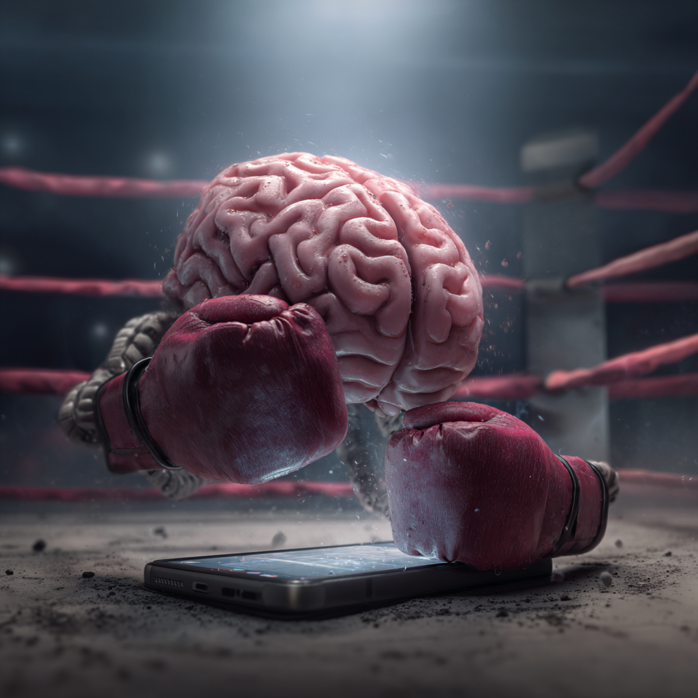
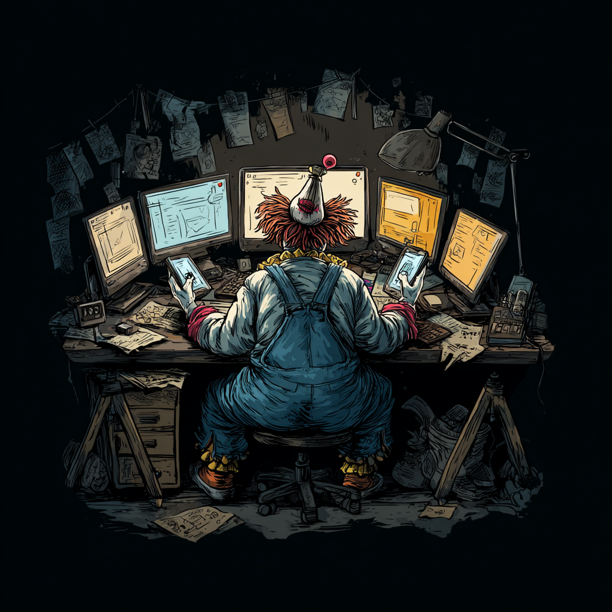
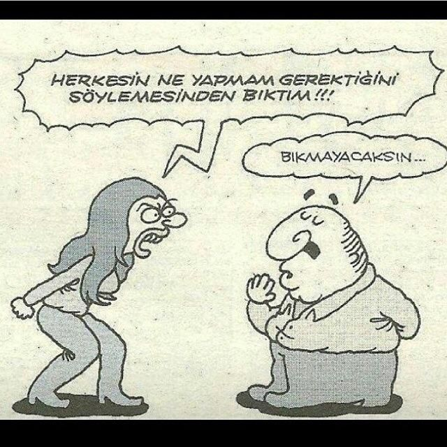
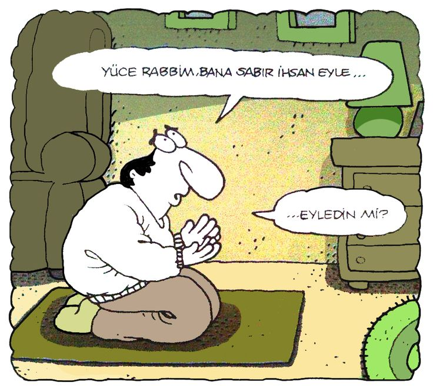

-------
geçmiş yazılar:

1. [Çevrenin Üzerimizdeki Etkisi - Bölüm 1: (Ah şu) İnsanlar linki](https://unnamed-idea.github.io/writing/2024/02/01/%C3%A7evrenin-etkisi) 

2. [Çevrenin Üzerimizdeki Etkisi - Bölüm 2: Ortam](https://unnamed-idea.github.io/writing/2024/02/20/%C3%A7evrenin-etkisi-b%C3%B6l%C3%BCm2) 

3. [Ön koşullama - priming](https://unnamed-idea.github.io/writing/2025/05/01/kosullama) 

4. [Öğrenilmiş çaresizlik, Matrix ve terapi](https://unnamed-idea.github.io/writing/2025/05/17/kosullama2) 

----

# obez bir beyin, kalorili bir teknoloji

Bilgiye aç varlıklarız. Merak sayesinde, tarım - hayvancılık ile başladık; yeni yerler keşfettik; topuk taşını, eliptik bisikleti bulduk ve Gibi dizisini çektik. İnsanlık tarihinin genelinde, ortamı kolaçan etmek, özgünlükleri bulmak (yeni bir tür bitki, yeni bir alet keşfi vb.), ilgiyi hızlıca değiştirmek ve tehditlerin farkına varmak (dinlenirken çalılardan duyulan bir ayı sesi ile alarma geçme) gibi eylemler en etkin hayatta kalma stratejileriydi. 

Günümüzde ise, bilgiye olan bu açlığımız dijital uygulamalar ile işgal edilmiş vaziyette. Bildirimlerin heyecanı,  reels'lerin sonsuz varyasyondaki ve bitmeyen kısa döngülü içerikleri, like'ların dürtüsü, içerikteki rastgeleliğin bağlayıcılığı beynimizin yeteneklerini sömürüyor.

Oldukça beğendiğim [distracted mind - dikkati dağılmış beyin](https://www.amazon.com/Distracted-Mind-MIT-Press-High-Tech/dp/0262534436)'de bilişsel süreçler (ing. [cognitive process](https://en.wikipedia.org/wiki/Cognition)) iki aşamada ele alınıyor: 
- aşağıdan yukarıya: duyu seviyesinden başlayıp beyne gelen süreç, örneğin korna duyunca dikkatimizin artması, hızlıca kenara çekilmemiz gibi
- yukarıdan aşağıya: beyinden başlayıp alt sistemlere inin süreç, örneğin asansör yerine merdivenle çıkmaya karar vermemiz gibi.

Bu yazıda, öncelikle beynimizdeki kaynakları tanıyıp, sonra bu kaynakları tüketip bilişsel yeteneklerimizin zayıflamasına sebep olan etkenleri, sıkılma duygusu ile beraber konuşacağız. Bize verdiği zararları deneyler üzerinden yorumlayıp neler yapabiliriz ile de bitireceğiz.  

# beynimizdeki sınırlı kaynaklar 

Yine Distracted Mind'dan alıntı yapacağım, zihnimizde bilişsel yükümüzü çeken kaynaklar 3 ana başlıkta inceleniyor, bunlar:

- dikkat mekanizması ([attention](https://en.wikipedia.org/wiki/Attention)): anlık olarak hangi bilgiyi işlemeyeceğini belirleyen sistem. Örneğin bir konuşmaya kulak kabarttığımızda etraftaki diğer sesleri de, görsel detayları da farketmiyoruz. 
- kısa süreli hafıza ([working memory](https://en.wikipedia.org/wiki/Working_memory)): Adı üstünde, kısa süreli olarak bilgi depolama sistemi. Okuduğunuz kitabın satırı, arkadaşınızı gördüğünüzde araya giren otobüse rağmen arkadaşınızın yerine otobüs geçince bakmanız vb. örnekler verilebilir. Dikkatimize göre bunun da duruma göre bir kapasite ve detay (fidelity) sınırı var. 
- hedef yönetme ([goal management](https://en.wikipedia.org/wiki/Goal_setting)): Hangi adımda neyi önceliklendireceğiz, bunu başarmak için sırasıyla ne yapmamız lazım sorularına cevap verip bu süreci yöneten sistem.

Bu kaynaklar sınırlı sayıda var, doğal olarak da her işe yetişemiyorlar. Kendi isteğimiz ile gelen bozucular (ders çalışırken telefon ile konuşma) veya dışarıdan gelen bozucular ( içli köfte için bulgur miktarını belirlerken duyulan korna sesi) ile kaynaklar arasında geçiş yapıyoruz.

Aynı zamanda, bilişsel yükümüz ilgilenmediğimiz sinyalleri dikkate almamak için de yoğun bir mesai yapıyor, birisini dinlerken etraftaki sesleri yorumlamamak gibi. Dikkate almamamız gereken şeyler de beynimizde bir işlem yükü.

Aşağıdaki video bazılarınıza tanıdık gelecektir, beyaz takımın yaptığı pasları sayarken, ...

<iframe width="700" height="400" src="https://www.youtube.com/embed/xNSgmm9FX2s" title="TFL Viral - Awareness Test (Moonwalking Bear)" frameborder="0" allow="accelerometer; autoplay; clipboard-write; encrypted-media; gyroscope; picture-in-picture; web-share" referrerpolicy="strict-origin-when-cross-origin" allowfullscreen></iframe>

... ekranın ortasındaki ayıyı görmüyoruz.

Bu bölümde anahtar temamız, beynimizin kaynakları sınırlı, ve farklı işler ile ilgileneceksek bu kaynakları boşaltıp doldurmamız gerekiyor. Aynı anda iki iş yapmıyoruz maalesef. Ve bu beynimizi strese sokuyor. Sıradaki başlıkta detaylandıralım.

# çoklu işlerde verimsiziz

Odağımızı dağıttığımız zaman, yukarıda bahsi geçen kaynakları öteki işe kanalize ediyoruz. Aynı anda iki işi yaptığınızı zannediyorsanız, aslında beynin bu mekanizmalarını bu iki iş arasında doldurup boşaltıyorsunuz.

Daha kötüsü, bu doldurma ve boşaltma da bir zaman alıyor ve aynı zamanda bir stres faktörü yaratıyor. Tabi iki işi de (veya ikinci iş video vb. dikkat dağıtıcı içerik ise bakılan ana işi) çok daha kötü ve verimsiz tamamlıyoruz.

Talha deneylere geç dediğinizi hiç duymasam da ben geçiyorum. 

 [Monsell'in 2003'teki deney](https://www.apa.org/topics/research/multitasking)inde, [Rubinsen'in 2001'deki deney](https://www.apa.org/pubs/journals/releases/xhp274763.pdf)inde ve daha bir çok deneyde, öğrenciler telefon, odak bozucu bir yan aktivite vb. ile ilgilendikçe başarımları düşüyor, aynı ödevi tamamlamak için ayırdıkları toplam süre, dikkat dağınıklığı vakitlerini saymayınca dahi daha çok tutuyor. Dikkat dağıtıcı olaylar önceden bildirilince dahi bu sonuçlar değişmiyor. 

Yetişkinler de benzer şekilde, [Ophir'in deneyinde](https://pubmed.ncbi.nlm.nih.gov/19706386/) çok fazla dijital içerik değiştiren insanlar, yine çoklu görevlerde (ing. multitask)  daha kötü sonuç gösteriyor. Aynı kişilerle tekrar tekrar denenince dahi sonuç değişmiyor. 

Benzer şekilde araç kullanırken telefon ile konuşmak dahi kaza riskini [4 kat artırıyor](https://nps.edu/documents/111291366/111353839/Infographic+-+The+Great+Multitasking+Lie.pdf/62e6eaaa-3595-49e6-9ea1-faa9756389f5?t=1459537774000). İş yerlerinde [e-mail, telefon vb. dikkat dağıtıcılar yüzünden bozulan odak uzun süre toparlanamıyor](https://www.psychologytoday.com/us/blog/mental-wealth/202402/the-pitfalls-of-multitasking-at-work). Çok daha uzun sürede iş tamamlanıyor ve stres faktörü yüksek oluyor.

Ve tüm bu bozulan odak ve çoklu görev geçişleri, yaptığımız şey çalışmak, eğlenmek vb. her ne olursa olsun [beynimizi strese sokuyor](https://www.brownhealth.org/be-well/multitasking-and-how-it-affects-your-brain-health).

Bu bölümde çoklu görevlerin, çalışırken de, eğlenirken de işe yaramadığını gördük. Sırada, neden dikkatimizi veremiyoruzu konuşacağız.

# odaklandıramadıklarımızdansınız

Bilgiye aç olduğumuzu söylemiştim. Beynimizi, dopamin reseptörlerini telefondaki ucuz içerik ile beslemeye alıştık. Gelen bildirimdeki / aramadaki yanıtlama dürtüsü ve sosyal medyaya bakmayınca bir şeyleri kaçırma düşüncesi kaygılandırıyor. Her bir like, bildirim, bir heyecan uyandırıyor. Sonsuz derinlikteki reelsler farklı içeriklerle ucuz bir şekilde bilgi açlığını kapatıyor. [The Molecule of More](https://www.goodreads.com/book/show/38728977-the-molecule-of-more)'da bahsedildiği gib, iyi veya kötü bir sonuç olduğunda değil, beklentilerimizdeki hataya göre dopamin salgılanıyor. Bu yüzden sahip olduklarımız ile yetinmiyor, yeni şeyler istiyoruz. Teknolojiye ise saldıracakları bir alan açmış oluyoruz.  

Ve bu ucuz içeriklere alışıyoruz, [beyin kapasitemiz de buna uyum sağlayacak şekide azalıyor](https://pmc.ncbi.nlm.nih.gov/articles/PMC11939997/). Beyin çürümesi 2024 yılının kelimesi seçildi. 
  
  Geçmiş yazılardaki değindiğim hazzı öteleme yeteneğine geliyoruz yine. O konuya çalışıp öğrenmek, uzun vadede karşılığını iş kurarak, bilgi paylaşarak, maaş alarak vermek vb. yerine, telefona dönüp oradan hazzı beslemek daha kolay geliyor. 

  Durum öyle garip bir halde ki, yapılan [deneylerde masa üstünde telefon varken, telefona bakılmıyorken dahi varlığından dolayı odak toplanamıyor](https://www.health.harvard.edu/blog/keeping-your-smartphone-nearby-may-not-be-so-smart-2017080212163).

  Ucuz şekilde, uzun vadeli etkilerini düşünmeden beynimizi besliyoruz ve bedelini toplum olarak ödüyoruz. 

tek sebebi bu olmasa da, bir çok ülkede [kaygı, ivmelenen bir oranda artıyor toplum içinde](https://pmc.ncbi.nlm.nih.gov/articles/PMC7441973/). Her ne yapıyorsak, doğru olanı yapmıyoruz.

Televizyonlar ilk yaygınlaştığında dikkati dağıttığı ve saatlerce kendisine odaklanıldığı için eleştiriliyordu. Şimdi, insanlar sosyal medyaya girmeden veya ikincil bir işle ilgilenmeden televizyon dahi izleyemiyor. Bir dönemin aşırısı, bir sonraki dönemin normali haline gelmesi de kaygı bozuklukları artışı gibi,  ne kadar kötüye gittiğimizin bir diğer göstergesi.

[Telefon kullanım süresi ile IQ düşüklüğü arasında doğrudan bağ var](https://uwaterloo.ca/news/heavy-smartphone-use-linked-lower-intelligence)

peki, ne yapmalı?

# ne yapmalı

Bu mücadelede beynimiz ve davranışınımızın beraber hareket etmesi gerekiyor. Öncelikle farkındalıkla başlıyoruz, [metacognition](https://en.wikipedia.org/wiki/Metacognition) Türkçesi üst biliş. Çoklu görevleri yapacak bir kapasitemiz olmadığının farkında olacağız, kabulleneceğiz. Araç kullanıyorsak telefona bakıp güvenli sürebildiğimiz sanrısına kapılmayacağız. Çalışıyorsak telefonun bizi nasıl etkileyeceğinin bilincinde olacağız. 

[Nudge](https://en.wikipedia.org/wiki/Nudge_(book)) güzel bir kitapdı, tercihlere, dolayısıyla insan davranışına ufak dokunuşlar ile yön verilebileceğini anlatıyor. Örneğin doğum kontrol haplarının belirli günlerde alınıp, belirli günlerde alınmaması gerekiyor. İnsanların unutmasını / karıştırmasını önlemek için, her güne bir hap olacak şekilde tabletler konulup, ilaç alınmaması gereken günderdeki tabletlerde etken madde konmuyor. Restoranlarda, menüdeki yemeklerin sırası ve renkleri oynanarak, sipariş verilen kalemlerin oranı oynanabiliyor. 
Kazanılan bölümden daha çok, kimlerle oda arkadaşı olduğu öğrencilerin başarısını etkiliyor. 

Konumuz ile alakası ise şu, her ne kadar beynimizi ikna etmek ana sebep olsa da, ilk iki yazımda belirttiğim gibi etrafımızdaki insanlardan ve eşyalardan etkileniyoruz. Eğlenirken / çalışırken telefonu uzakta tutmak vb. herkesin kendine göre uyarlayacağı çözümler var. Kitabı da tavsiye ederim.

Uyku beyin sağlığı için elzem, ve burada da [telefonlar düşman safında karşımıza çıkıyor](https://pmc.ncbi.nlm.nih.gov/articles/PMC9707689/). Yatmadan önce ve uyandıktan sonra telefonsuz zaman tavsiye ediliyor. 

Sıkılma ([boredom](https://en.wikipedia.org/wiki/Boredom)) da unutulan karakteristik özelliklerimizden. Düşüncelerimiz ile başbaşa kalamıyoruz, yüzleşmedikçe daha da basit şekilde sıkılmaya başlıyoruz (örn. yukarıda değindiğimiz, televizyon izlemenin bile sıkıcı hale gelmesi). Acıyla yüzleşmek gibi, sıkılma ile de yüzleşmemiz gerekiyor.
Meditasyon çerçevesinde, neyi deneyimlediğimizden/yaşadığımızdan daha çok, o deneyimi nasıl yorumladığımız çok daha önemlidir şeklinde bir parça okumuştum. Bunu da bu konuya bağlamak istiyorum 

Hem beyin, hem davranış tarafında yapabileceklerimiz konuştuk. Son olarak, okuduğum tüm kitapların olmazsa olmazı, literatürde doğudan batıya, ileriden geriye herkesin, ama herkesin mutabık kaldığı belki de tek ortak payda var: fiziksel egzersiz. [uzun süreli deneyler ile bir çok kez egzersizin bağımlılıkları azalttığı, zihni kuvvetlendirildiği gösteriliyor](https://pmc.ncbi.nlm.nih.gov/articles/PMC12304691/#:~:text=Most%20found%20an%20inverse%20relationship,smartphone%20addiction%20symptoms%20over%20time.).  Hem hormanal dengeleri düzenliyor, hem zihni dinç ve irade gücünü kuvvetli tutuyor, kaygıyı azaltıyor, doğal yoldan vücuda ve beyne ödül veriyor. Bunun bir yan kırılımı olarak da beslenme var, [beslenme zihni ve bağımlılığı tetikliyor](https://www.mdpi.com/2813-1851/4/3/19). Yine bunu da başarmak için gereken irade, fiziksel aktivite ile pekiştirilebiliyor.

Sıkıldık mı :)

-------
geçmiş yazılar:

1. [Çevrenin Üzerimizdeki Etkisi - Bölüm 1: (Ah şu) İnsanlar linki](https://unnamed-idea.github.io/writing/2024/02/01/%C3%A7evrenin-etkisi) 

2. [Çevrenin Üzerimizdeki Etkisi - Bölüm 2: Ortam](https://unnamed-idea.github.io/writing/2024/02/20/%C3%A7evrenin-etkisi-b%C3%B6l%C3%BCm2) 

3. [Ön koşullama - priming](https://unnamed-idea.github.io/writing/2025/05/01/kosullama) 

4. [Öğrenilmiş çaresizlik, Matrix ve terapi](https://unnamed-idea.github.io/writing/2025/05/17/kosullama2) 