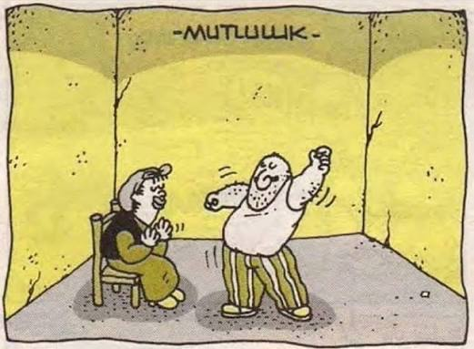
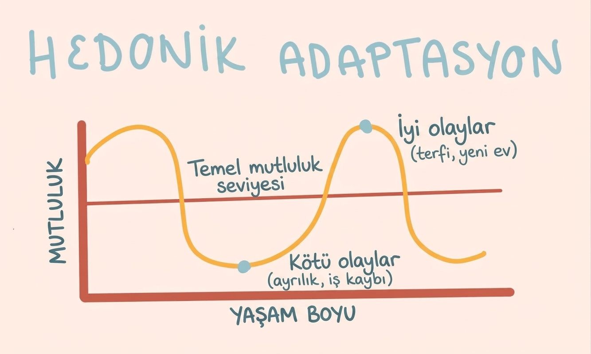
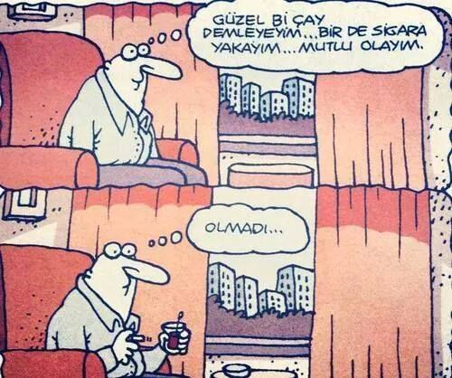
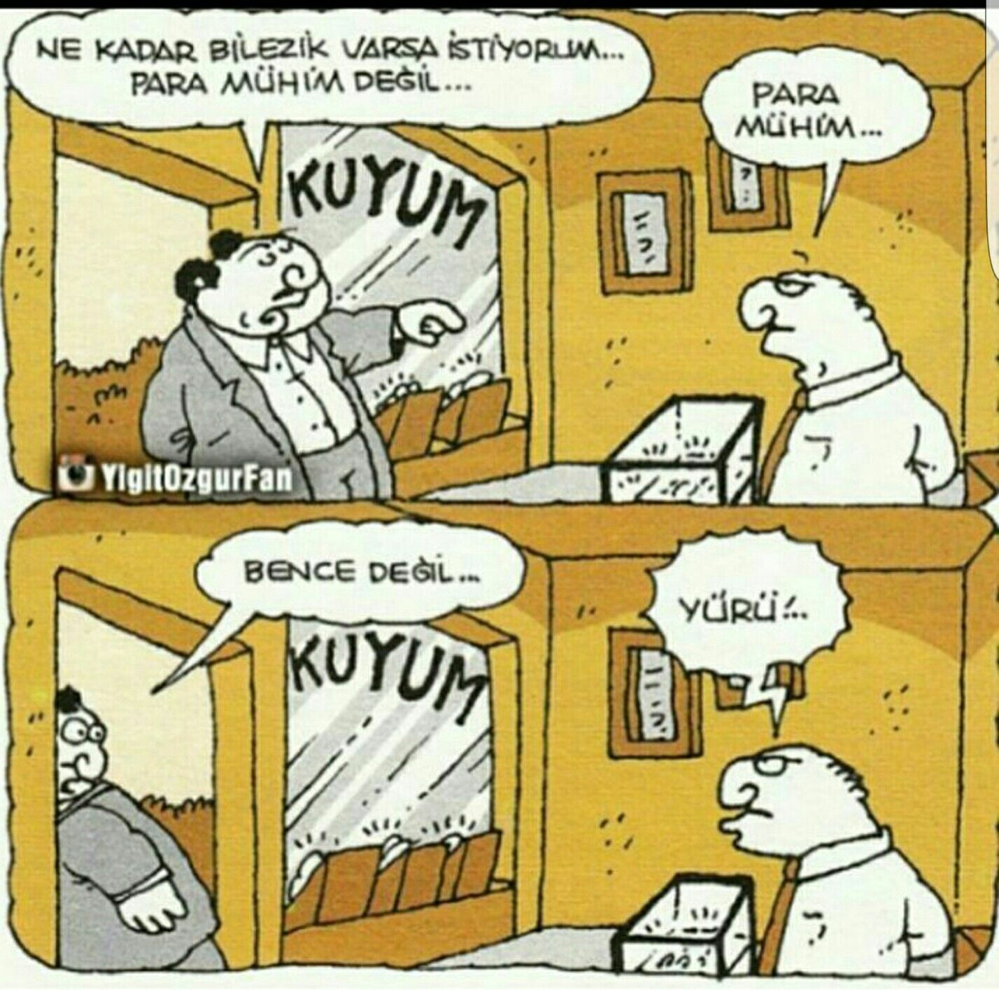
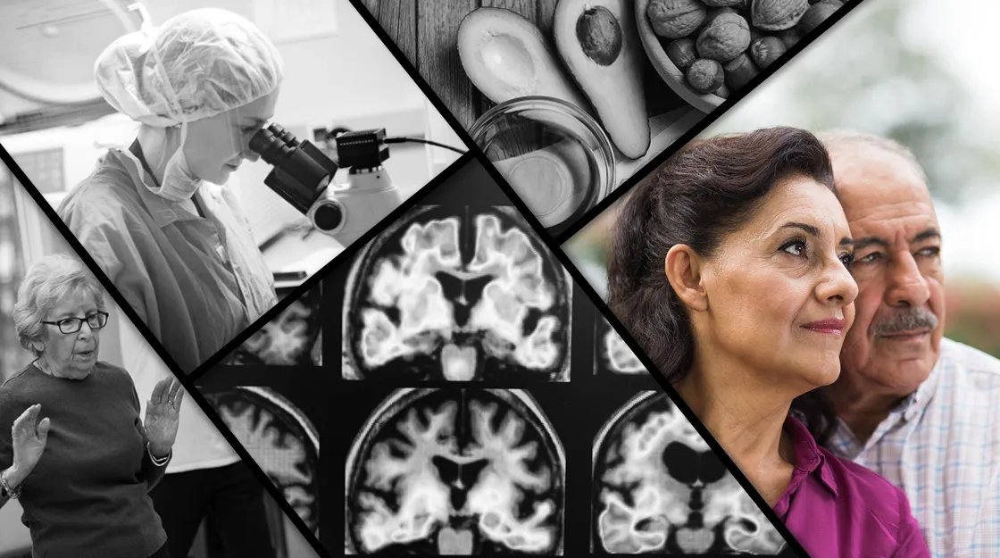
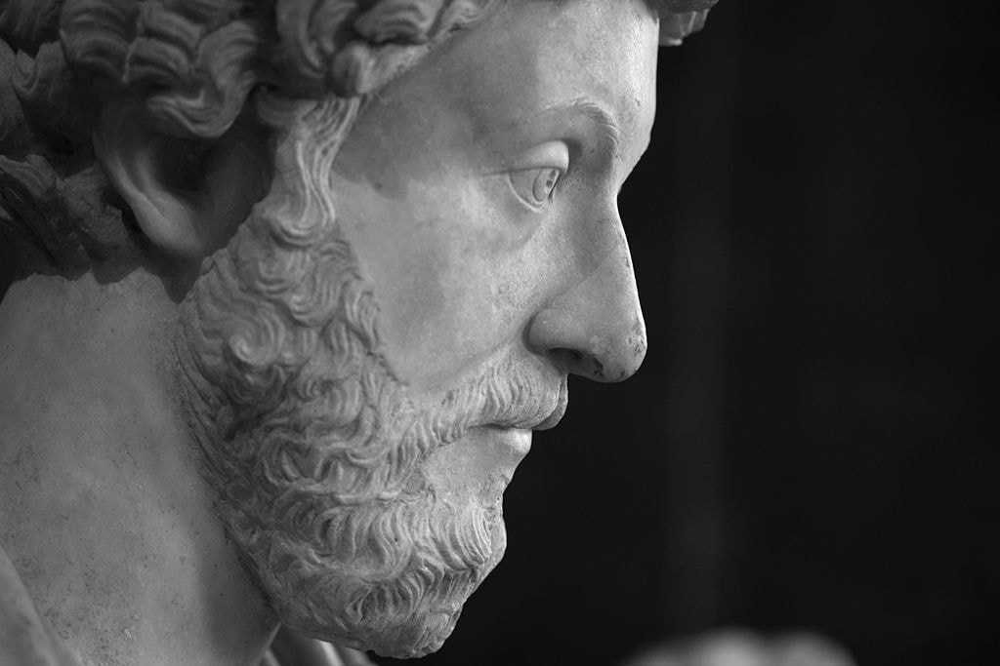

Uzun bir ara vermişim, geçmiş yazılarda sözünü verdiğim, mutluluk psikolojisindeyiz şimdi. Çevrenin etkisi yazı dizisinde değindiğim sosyal psikoloji ile beraber favori konularımdandır pozitif psikoloji ve mutluluk psikolojisi.

# Pozitif psikoloji

Pozitif psikoloji bu yazıdaki bir çok başlığın üzerine çalışan bilim dalı. Geleneksel yaklaşımlar zihinsel hastalıkların teşhisi ve tedavisine uğraşırken pozitif psikoloji alanı ise hayat kalitesi, yaşam tatmini nasıl artırılır'ı, mutluluk psikolojisi dinamikleri nelerdir gibi konuları çalışıyor. Bir çok kişiye, pozitif psikoloji'nin markette manav reyonunun yanındaki kitaplar ve oradaki konu başlıkları ile ilgisi olmadığını, kontrollü deneyler ile ilerleyen bilimsel bir alan olduğunu anlatmaya çalışıyorum :)

# Mutluluk tanımı, nicel ifade zorluğu

İşin sıkıcı tarafıyla başlamak istiyorum. Mutluluk halen objektif olarak ölçülemeyen bir duygu durumu. Ölçümü için kişinin kendi beyanı esas alınıyor. [Bu beyanlar buradaki gibi bir mutluluk ölçümü formu ile ölçülüyor](https://recwellness.uccs.edu/sites/g/files/kjihxj2336/files/inline-files/Oxford-Happiness-Questionnaire.pdf). Bir diğer yöntem ise telefon vb. üzerinden deney grubuna rastgele olarak farklı gün ve zamanlarda bildirim gönderiyor ve anlık mutluluk seviyelerini girmeleri bekleniyor. 

Bu yöntemlerde güzel bir nokta var: her ne kadar çok bilimsel gözükmeseler ve kişinin beyanını esas alsalar da, bu metotların oldukça [güvenilir sonuçlar verdiğini okumuştum](https://www.researchgate.net/publication/225400428_Self-Informant_Agreement_in_Well-Being_Ratings_A_Meta-Analysis). İnsanların kendilerine verdiği not, genellikle dışarıdan da gözlemler ile korele oluyor. Bireylerin kendilerine verdiği puanların global bir referansı olmasa da pratikte kişilerin kendilerini tanıdığı gözlemleniyor. 

Bu satırları yazarken aklıma insan beyninin kendini daima haklı çıkarmaya çalıştığı [cognitive dissonance](https://en.wikipedia.org/wiki/Cognitive_dissonance) ([bilişsek çelişki](https://tr.wikipedia.org/wiki/Bili%C5%9Fsel_%C3%A7eli%C5%9Fki)) geldi, demek ki mutluluk puanlarımızı kendimizi sıkıntılı atfedecek bir bildirim olarak görmüyoruz.

Mutluluğa iki ayrı kanaldan yaklaşılıyor. Hedonik mutluluk zevk ve keyif alma, acıdan kaçınmaya dayanıyor. Eudaimonik Mutluluk ise kendini gerçekleştirmeye, anlam aramaya ve erdemli bir yaşam sürmeye dayanıyor.

[Ed Diener 2013’deki yayınında](https://papers.ssrn.com/sol3/papers.cfm?abstract_id=2306651) da mutluluk hissini 1. gündelik hayattan zevk alması, 2. kişinin becerilerini kullanarak anlamlı işlere yönelik fayda sağlaması, 3. aile, din, toplum gibi kendi benliğinden büyük sebeplere katkı sağlaması faktörlerine bağlıyor. Bu amaç, çaba, ve pozitif duygularla beraber negatif duyguların azlığının kesişim kümesi mutluluk oluyor.

# hedonik adaptasyon

Hedonik adaptasyon, mutluluğumuzun çeşitli dış faktörler ile artması veya azalmasının ardından, nominal seviyeye geri dönmesini sağlayan psikolojik yönelime verilen isim. Ana fikir şu şekilde, iyi olayların arkasından (yeni bir ilişki başlangıcı, görevde yükselme, para kazanma vb.) mutluluğun geçici olarak zıplaması, ardından eski seviyesine doğru sönümlenmesi ile sürekli nominal seviyede kalan bir mutluluk var. 

Benzer şekilde kötü olayların da (sakatlık, maddi kayıp vb.) sebep olduğu darbeden sonra zamanla mutluluğun eski seviyesine dönmesi şeklinde bir örüntü var. Mutluluk psikolojisi disiplinin ilgilendiği ana konulardan birisi de bu: olumsuz olaylarda otomatik olarak yukarıya çıkarılıyor olmamız güzel, ama olumlu olaylarda da aşağıya çekilmemizi önleyebilir miyiz? Sizce?
# Genler mi?

[Lykken](https://en.wikipedia.org/wiki/David_T._Lykken)'in yaptığı [çalışmada](https://journals.sagepub.com/doi/10.1111/j.1467-9280.1996.tb00355.x) 1930'lardan 1950'lere kadar beraber büyüyen veya ayrı yasayan ikizler üzerinden mutluluk seviyeleri ölçülüyor. Ayrı yaşayan ikizlerin mutluluk seviyeleri beraber yaşayanlar ile büyük ölçüde aynı. Çalışmada genetik faktörlerin %50 civarında belirleyici olduğu tespit ediliyor. Bu çalışmadan sonra Lykken meşhur olan şu sözünü söylüyor: mutluluğu artırmaya çalışmak boyunuzu uzatmaya çalışmaya benzer.

Durun daha umutsuzluğa kapılmayın bitmedi yazı :)

[Brickman 1978’deki piyango çalışmasında](https://psycnet.apa.org/record/1980-01001-001) piyango kazanan insanları ve çeşitli kaza / sakatlık geçiren insanları üçüncü bir kontrol grubunu ile beraber seçiyor ve inceliyor. Yalnız bu çalışma boylamsal bir çalışma değil, yani aynı kişiler uzun dönem içinde sürekli incelenmiyor, anlık mutluluk fotoğrafları çekiliyor, birbirleri ile kıyaslanıyor. Bu çalışmada olumlu veya olumsuz havadislerin tahmin edildiği kadar mutluluk seviyesine etki etmediği raporlanıyor.

Lucas'ın daha kontrollü ve uzun dönem (boylamsal) çalışmaları hedonik adaptasyonun asimetrik olduğunu gösteriyor. [2003 yılındaki çalışmasında](https://psycnet.apa.org/record/2003-01588-009) evlilik sürecinde yaklaşık iki yıllık bir mutluluk artışının ardından mutluluğun temel seviyeye döndüğünden bahsediyor. 

2004 yılındaki [işsizlik](https://pubmed.ncbi.nlm.nih.gov/14717825/) ve 2005 yılındaki [boşanma çalışmalarında](https://journals.sagepub.com/doi/10.1111/j.1467-9280.2005.01642.x) ise, kötü havadislerden sonra iyileşme olsa da eski seviyeye gelinemediği veya yeterince hızlı gelinemediğini belirtiyor, yani hedonik adaptasyonun asimetrik olduğu, iyi havadislerde hızla geriye dönerken kötülerde yavaş yavaş dönüldüğü belirtiliyor.

# mutlulukta %50 genetik, %10 dış etmenler, %40 bakış açımız tartışması

Isınmaya başladık, derinlere inelim o zaman. [How of happiness](https://thehowofhappiness.com/) kitabı bu alana girerken ilk okumalarımdan birisiydi. Etkilenmiştim. [Lyubomirsky](https://en.wikipedia.org/wiki/Sonja_Lyubomirsky), Lykken'in ikizlerinin de dahil olduğu, farklı gruplar ile yapılan araştırmalar sonucunda genetik faktörlerin mutluluk seviyemizdeki ağırlığının %50 olduğunu pekiştiriyor. 

Kitapta bahsedildiğine göre bu oran boy uzunluğunda %85 - 90 arası, yani boyumuzda çabalayarak değiştirebileceğimiz %10'luk bir alan varken mutlulukta %50 gözüküyor. Geriye kalan bu %50'yi açarsak, sadece %10'luk kısım yaşam koşullarını kapsıyor - geliriniz, medeni hal, meslek, yaşadığınız şehir vb. unsurlar. Çok düşük geliyor değil mi?

Lyubomirsky'e göre mutluluğa etki eden son %40'lık kısım ise bilinçli yaptığımız, değişikliğini yönetebildiğimiz eylemlerden, düşüncelerden, hayata bakış açımızdan geçiyor. Yani genetikten, dış koşullardan ayrı olarak %40'lık bir etki gücümüz olduğunu, bu kısmın doğrudan bizim kontrolümüzde olduğunu, dolayısıyla mutluluğumuzu büyük bir oranda değiştirebileceğimizi savunuyor.

Tüm bu yaklaşım oldukça eleştirildi, bir alt başlıkta detaylandıracağız.
# genetiğe eleştiriler

Bu 50-10-40 oranı çok büyük eleştirilere maruz kaldı Eleştirilerin (haklı olarak) gerekçesi, kendi etki alanımızda olduğu iddia edilen %40'lık oranın aslında genetik faktörlerden ve dış etmenlerden bağımsız değerlendirilemeyeceği. Kalıtsal olarak içe kapalı ve depresif bir kişinin, çevresi, kararları ve düşüncesi de benzer şekilde ve birbirini etkileyip tetikleyen bir yapıda. Bu kişi hayatta olumsuzluklara daha çok odaklanacak, çevresi buna göre oluşacak, düşünce biçimi de her olaya bu perspektiften bakacak.

Eleştirilen bir diğer nokta, bu oranların popülasyondaki etki faktörü olduğu (farklı insanlarda genetik faktörlerin ağırlığı %50 oranında tutarlı gibi), ve aynı şekilde bireyin kendisine indirgenemeyeceği (%40 tamamen kendi iradesinde varsayımı) oldu.

Lyubomirsky de daha sonra [bu yayını ile](https://sonjalyubomirsky.com/wp-content/uploads/2024/03/Sheldon-Lyubomirsky-2019.pdf) eleştirileri kabul edip geri adım atıyor ,yalnız yeniden bir oran veremese de, halen elimizdeki irade ile hedonik eşiğimizi yukarıya çıkarabilmenin mümkün olduğunu belirtiyor. İnsanların çabalayarak daha yüksek mutluluk seviyelerine ulaşması mümkünken, yüzde kaç etki etmesie takılmadan elimizden geleni ortaya koyalım diye konuyu bağlıyor diyebiliriz.

**Önümüzdeki paragraflarda da değineceğiz, çoğu zaman dopaminde, hedonik mutlulukta zirve noktamız zirveye ulaşılan an değil, zirveye giderkenki akış hali, çabalama devri. Bütün hayat yolculuğunu da böyle düşünürsek, mutluluk bir hedef değil, erdemli bir yolda giderken yanımıza eşlik edecek yol arkadaşı diyebiliriz.**

[Espen Røysamb](https://scholar.google.com/citations?user=v8rAQvsAAAAJ&hl=en) ikizler çalışmasını yeniden değerlendiriyor ve genlerin kader olmadığını, ortamımızı ve düşüncemizi kontrol ederek değişikliklerin mümkün olduğunu belirtiyor. Daha sonrasında Lykken de verdiği demeçlerde ilk görüşlerinin fazla katı olduğunu, mutluluk eşiğinde iyileşmelerin mümkün olduğunu söylüyor.

# Para

Piyango kısmında dolaylı olarak bahsi geçse de, bir mutluluk yazısında para bahsi geçmezse "para"lanıp "para"m "parça edilirsiniz:)

En özeti en başta söyleyelim; klişelerin aksine para da mutluluğu artırıyor. Yalnız, açlık sınırındaki yoksulluktan itibaren paranın mutluluğa etkisi parabolik olarak azalıyor. Ele geçen para açlık veya barınma problemini kapatıyorsa çok büyük bir etkiye sahipken, 4. evinizi 5. eve çıkaracak paranın sizin hayat kalitenize ve mutluluğunuza etkisi bir o kadar düşük kalıyor. Önceki başlıklarda değinilen %50 genetik %10 dış faktörler %40 bakış açınız kısmının o dış faktörler kısmında barınıyor para.

**İç huzur olmadıktan sonra, para sadece problemlerinizin adını değiştiriyor. Markette indirimli ürünü yakalayamamanın can sıkıntısı ile yatağa girmenin yerini,  davet edildiğiniz kokteylde protokole en uzak masaya oturtulmanız alıyor**, ama siz aynı derecede mutlu ve mutsuzsunuz. [Kahneman](https://tr.wikipedia.org/wiki/Daniel_Kahneman) 2023'teki [çalışmasında](https://www.pnas.org/doi/10.1073/pnas.2208661120) paranın etkisini kişinin moduna da bağlıyor, mutsuz bir kesim için belirli bir eşikten sonraki paraların yardımı olmazken, pozitif insanlarda ek paranın etkisi de daha büyük oluyor.

Ayrıca şahsen okumalarda gördüğüm genel örüntü, paranın olumlu etkisinin, marka - lüks vb. bir şeyleri almaktan ziyade, kendine vakit yaratma ve değer verdiğin durumlara vakit ayırabilme gücü yaratmakta oluyor.

# mutluların ortak özellikleri

En büyük ve tutarlı örüntü, mutlu insanlar çevreleri ile güçlü sıcak ilişkiye sahipler. Harvard deneyi oldukça güzel ve eğlenceli, bu bölümün teması olacak. buyrunuz:

## sosyal bağlar - Harvard deneyi

[The Harvard Study of Adult Development](https://news.harvard.edu/gazette/story/2025/05/things-money-cant-buy-like-happiness-and-better-health/) çalışması tarihte mutluluk üzerine yapılmış en uzun çalışmalardan, 1938 yılında başlayan çalışma şu an ilk deneklerin eşlerini ve çocuklarını da kapsıyor ve halen devam ediyor. On yıllar boyunca görüşmeler, tıbbi muayeneler, beyin taramaları yapılıyor.
Mutluluk çarpanı en yüksek maddenin, kişinin aile ve arkadaş çevresi ile ilişkilerinin kalitesi ve samimiliği olduğunu gözlemleniyor. Bu ilişkiler, kişinin fiziksel sağlığının ve ruh sağlığının en büyük göstergesi ve bunları servetten, genetikten ve bulunduğu sosyal sınıftan daha iyi tahmin ediyor.

Benzer şekilde 50 yaşında kişinin ilişki kalitesi, 80 yaşına geldiğindeki sağlık durumunu kolesterol seviyesinden daha iyi tahmin ediyor. Çok güzel bir veri, bu gözlemleri yapmak için gerçekten aynı kişiler 30 yıl boyunca gözlemleniyor.

## yalnızlık

Harvard çalışmasına devam ediyoruz, [ilişkileri yürütmek sürekli bir ilgi ve özen gerektiriyor](https://news.harvard.edu/gazette/story/2017/04/over-nearly-80-years-harvard-study-has-been-showing-how-to-live-a-healthy-and-happy-life/). Kişilerin sosyal fitness'i azaldıkça yalnızlık artıyor. Alt paragrafta tekrar değineceğim ama bu satırdaki referansta da belirtildiği gibi, izolasyon ve yalnızlık toksik bir şey, ve sigara - alkolizm gibi fiziksel sağlığa dahi darbe vuran zararlı bir etmen. Nereden geldik - mutlu insanlar bu yalnızlıktan çoook uzaktalar.

### diğer ortak özellikler

Mutlu insanların bir diğer özelliği ise nitelikli meşguliyet ve akış (flow) durumu. Severek yaptığı bir iş veya meşkalede kendini kaybetmek, sınırlarını zorlamak da önemli bir mutluluk indikatörü. Mutlu insanlar, kendileri için önemli işler ile meşgul oluyorlar.

Öteki insanlar ile ilgilenmek, zaman ayırmak da kendine zaman ayırmaktan çok daha fazla ölçüde mutluluk indikatörü.

Ve genel kanı, bu insanlar mutlu olmaya çalışmıyor, mutluluğu kovalamıyor, ama kendilerini bir hayat hedefine, ilişkilere, projelere adayıp, bu adanmışlığın meyvesi olarak da mutluluğu alıyorlar.

# false cause: yanlış neden safsatası

False cause yani yanlış sebep [safsatası](https://tr.wikipedia.org/wiki/Safsata), neden sonucun yanlış kurulmasını tanımlayan bir mantık yürütme hatası / safsatadır. Örneğin dün hava bulutluydu bugün de lastiğim patladı (her iki olay da gerçek) demek ki hava bulutlu olunca lastiğim patlıyor. Veya Kahnemann'ın bir çok örneğinde olduğu gibi, şu işleri yaptığım için şirket bu kadar başarılı oldu (aslında tamamen şans veya şirketin yükselmesi yaptığın o işlerle hiç bağlantılı değil) gibi.

Bu konumuzla da çok ilgisi var, en temel ve haklı eleştiriler şu şekilde geliyor: mutlu insanlar böyle yaptıkları için mi mutlular, yoksa mutlu oldukları için mi böyle yapıyorlar.

Kardeşimle güzel bir espri konseptimiz vardı; sabah kalkınca yatağını toplayıp düzgün bırakmak mutlu insanların sıkça gözlemlenen bir davranışı. Yatağımı da topladım neden hala canım sıkkın o zaman :)

Maalesef net bir cevap yok, ama aradaki örüntü her türlü iki taraf arasında hizmet veriyor, bu yüzden denemek, o yolun yolcusu olmak daima faydalıdır ve bize bir şey kaybettirmez diye düşünüyorum. Kaldı ki zorla yapılan şeylerde dahi güzel etkiler oluyor, [örneğin kalem vb. bir nesne ısırtıp yüz kasları gülümser hale getirilince insanların modu da yükseliyor ve daha olumlu oluyorlar](https://www.nature.com/articles/s41562-022-01458-9).

Yani mutlu insanların davranışlarına dair sebep sonuç ilişkisinden emin olmasak dahi, o örüntüleri denemek, o yolda çabalamak güzel, emin olun bizi ilerletecek.

# rahibe deneyi

[Bayıldığım bir deney](https://en.wikipedia.org/wiki/Nun_Study). 678 rahibe ile yapılan boylamsal (uzun soluklu) bir deney, önceki başlıklarda konuştuğumuz Harvard deneyi gibi. Bu deney de oldukça kapsamlı, rahibelere yıllık fiziksel ve psikolojik muayeneler yapılıyor, hareketleri yakından takip ediliyor, ölümlerinde beyinleri de incelenmek üzere alınıyor. 60 yıl boyunca takip ediliyorlar.

En güzel çıktı şu; rahibelerin giriş mektup yazılarında olumlu, enerjik şekilde yazanlar yaklaşık 7 yıl daha uzun yaşıyor. Olumlu yazılar yazanlar on yıllar sonra düşük kortizollü, daha iyi bağışıklık sistemine sahip kişilerin göstergesi oluyor.

Karşı argümanın da en güçlü olduğu konu yanlış sebep safsatası; o kadınlar genetik olarak dışa dönük, olumlu, yapıcı, neşeli oldukları için mektupları da öyle yazdılar ve ömürleri de daha uzun oldu? Önceki başlıkta bahsettiğim gibi hangisi sebep hangisi sonuç olursa olsun aradaki ilişki köprüsü bize bir rol model oluşturuyor.

# batı doğu ekolleri

  |                                                                                                                                        |                                                                                                        |
  | ---------------------------------------------------------------------------------------------------------------------------------- | ------------------------------------------------------------------------------------------------------ |
|||  

Yayınlar batı eksenli olduğu için tek taraflı oldu. Doğu bloğunda memnuniyet, ve positif - negatif duyguların beraber bulunması bekleniyor. Klasik batı ekolünde ise olumlu durumların maksimize edilip olumsuzların minimize edilmesi rasyonel hedeflerden.

Batı ekolündeki bireyselliğin yerini doğuda kümülatif mutluluk ve huzur alıyor, ve bir taraf mutluluğu daha çok hedef görürken öteki taraf mutluğu doğru yaşam olursa yanınızdaki bir ziyaretçi olarak görüyor.

Özetle batıda anahtar kelimeler birey, kişisel kimlik ve başarı ekseni merkezde iken doğu yaklaşımında topluluk, ilişkiler ve ortak uyum merkezde oluyor.

Güzel olan nokta ise, uygulamada her tarafın birbirine yaklaşmış olması, motivasyonlar farklı olsa da benzer basamaklar tırmanılıyor.

Yeteri kadar okumam olmadığı için [Ikigai](https://tr.wikipedia.org/wiki/Ikigai) , Mesnevi vb. derinlemesine giremeyeceğim. [Sadi](https://tr.wikipedia.org/wiki/Sad%C3%AE-i_%C5%9E%C3%AEr%C3%A2z%C3%AE)'nin Bostan ve [Gülistan](https://tr.wikipedia.org/wiki/G%C3%BClistan_(kitap))'dan da bu yazımdaki konularla ilgili mesajlar var: 

Gerçek zenginliğin kanaat olması ve başkalarıyla kıyaslamayı bırakmak: Bu maddeler pasifliği veya ezilmeyi dikte etmiyor, şükran duygusunun farklı bir betimlemesi aslında. Mücadeleni vereceksin ama sonrasında da nasip neyse onu alıyorsun. Hırsın getirdiği mutsuzluk ve cömertliğin getirdiği sevinç de önceki başlıklardaki paylaşımcılığı pekiştiren örneklerden. 

Sadi, başkalarının derdine derman olan kimsenin en saf mutluluğu yaşayan kimse olduğunu da Bostan'da söylüyor. Son olarak geçmişin pişmanlıklarına takılıp kalmamak, olgunlaşmak ve yeni şeyler öğrenmek de Sadi'den flow'a, hazcı değil de anlamsal mutluluk yolunda mutlu insanlarda da ortak görülen odaklanma - faydalı işlerle uğraşma davranışlarına selam çakıyor. Aynı yere çıkan yolları görmek size de mutluluk veriyor mu :)

[Fabl](https://tr.wikipedia.org/wiki/Fabl)'lar da ayrı birer cevher ama pas geçiyporuz.
Bülbülname'ye ise ilerde değineceğim.

----
[Bölüm 1 sonu. Bölüm 2'de mutluluk reçetelerini, mücadele etmeyi ve gergedan boynuzunu konuşacağız, bölüm 2 için buyrun.
](/writing/2026/11/19/mutluluk2.html)

[BÖLÜM 2 LİNKİ
](/writing/2026/11/19/mutluluk2.html)

-------
geçmiş yazılar:

1. [Çevrenin Üzerimizdeki Etkisi - Bölüm 1: (Ah şu) İnsanlar linki](https://unnamed-idea.github.io/writing/2024/02/01/%C3%A7evrenin-etkisi) 

2. [Çevrenin Üzerimizdeki Etkisi - Bölüm 2: Ortam](https://unnamed-idea.github.io/writing/2024/02/20/%C3%A7evrenin-etkisi-b%C3%B6l%C3%BCm2) 

3. [Ön koşullama - priming](https://unnamed-idea.github.io/writing/2025/05/01/kosullama) 

4. [Öğrenilmiş çaresizlik, Matrix ve terapi](https://unnamed-idea.github.io/writing/2025/05/17/kosullama2) 

5. [Dikkaaat: obez bir beyin](/writing/2025/11/23/dikkaaat.html)