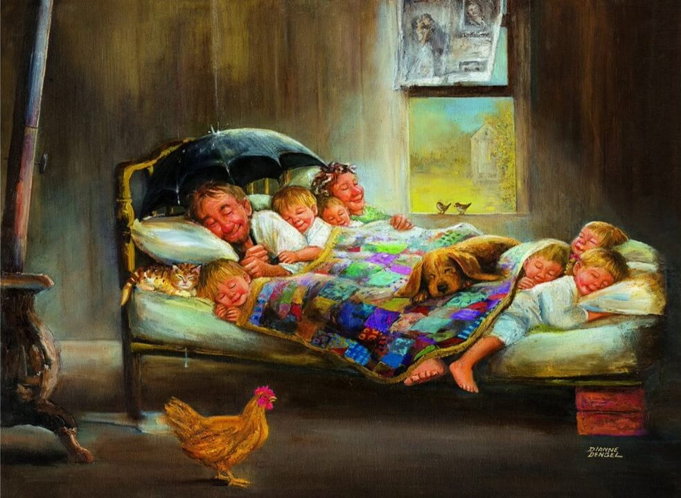
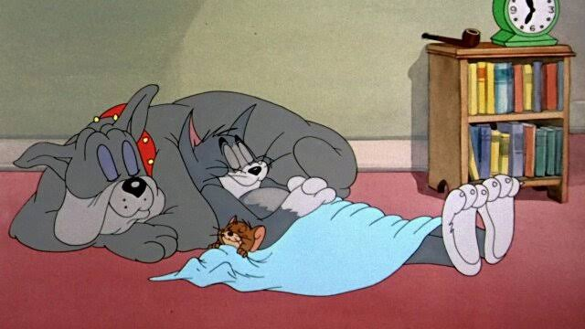
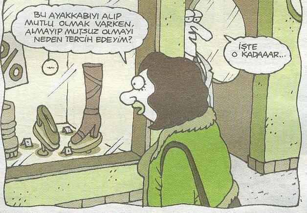
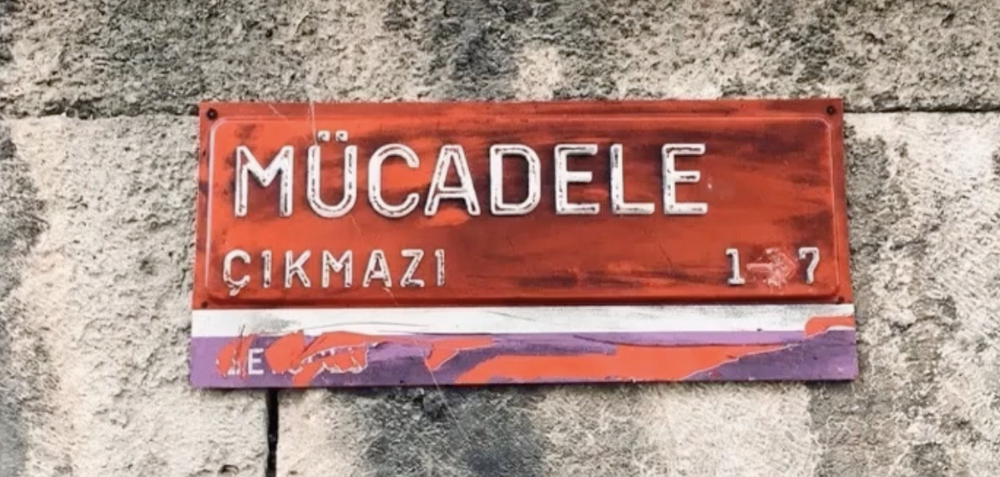
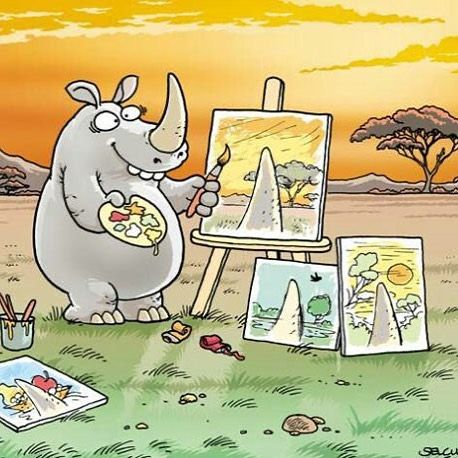

Bölüm 1'de kaldığımız yerden devam ediyoruz, 
[ilk part için bölüm 1 linki](/writing/2026/11/18/mutluluk.html)

# Çare ne patron, öldük mutsuzluktan

Ben de yaza yaza pazarlamacı bir esnaf oldum, çareyi en sona ayırıyorum :)

Öncelikle sihirli bir buton yok. Şu kelimeyi söyleyince, bu eylemi yapınca abilerim ablalarım her şey çok daha güzel olacak, hayır olmayacak. Hayat kolay değil, mücadele istiyor.

### sosyal bağlar

Zaten sosyal canlılarız, mutluluk ile korele en temel faktör de bu. Alternatiflerini, bunun yerine bir şey koymayı aramak yerine bu maddenin hakkını vermemiz lazım. Evlilik ve yakın ilişkiler, dostluklar, aile ve arkadaş çevreleri bu bağları oluşturuyor. Yukarıdaki gördüğünüz mutluluğun tablosu konuştuğumuz bir çok şeyi çok güzel özetliyor.

Önceki maddelerde konuştuğumuz [Harvard çalışması](https://news.harvard.edu/gazette/story/2017/04/over-nearly-80-years-harvard-study-has-been-showing-how-to-live-a-healthy-and-happy-life/) 80 yıldır 2000e yakın kişi ile devam ediyor, orta yaşlarda kaliteli ilişkisi olan kişiler 80 yaşında da çok daha iyi durumda fiziksel sağlığa ve mutluluk seviyelerine ulaşmış oluyorlar, ve burada sosyal bağlar kolesterol seviyelerinden daha belirleyici indikatör oluyor. [Holt-Lunstad'ın 100den fazla çalışmadan çıkardığı sonuç](https://pubmed.ncbi.nlm.nih.gov/39279411/) da güçlü [sosyal bağların yaşam kalitesi ve ömür süresinde çok belirleyici bir rolde](https://journals.plos.org/plosmedicine/article?id=10.1371/journal.pmed.1000316) olduğunu söylüyor.

Rahibe deneyinde doğrudan mutluluk üzerinden ömür tahmini tutarlı sonuç vermiyor her zaman diye konuşmuştuk, burada arada sosyal bağlar köprü oluyor. sosyal bağlar kaliteli, uzun bir yaşam için net bir indikatör.

Benzer şekilde evlilik ve ilişki kalitesi de öyle. Evlilik ve yakın ilişkiler veya çok fazla arkadaş otomatik olarak mutluluğu veya kaliteli sosyal bağları getirmiyor. Bağların kalitesi sizin deneyimlediğiniz mental tatminler ile subjektif olarak ölçülüyor, yani ölçülemiyor :)

### egzersiz

Tüm [yayınlarda ortak görülen](https://pmc.ncbi.nlm.nih.gov/articles/PMC7369812/), herkesin üzerinde mutabık kaldığı madde. Ben konuşmalarımda şu şekilde anlatıyorum, bazı kişiler acı yemeği, bazıları ekşi tatları sever, ama organik canlılarız, sıcaktan herkesin eli yanar. Mutluluk için de aynı şekilde, kendinizi yorduğunuz bir aerobik egzersiz (yürüyüş, koşu, bisiklet, yüzme) sizin hayat tarzınız, kişiliğiniz, genleriniz ne olursa olsun ruha çok çok iyi geliyor.

Fiziksel sağlığa etkilerine gelmedik, sporun yalnızca ruhumuza dokunuşu bile muazzam. Psikoloji - terapi ekseninde nasipse gelecekteki yazılarda değiniriz ama depresyona karşı da korelasyonu mutluluktan bile fazla. 

### yalnızlıktan uzaklaşmak

  |                                                                                                                                        |                                                                                                        |
  | ---------------------------------------------------------------------------------------------------------------------------------- | ------------------------------------------------------------------------------------------------------ |
|||  

Yalnızlık da sosyal bağlar denkleminin tersten hesaplanmış hali. Yalnızlığı şöyle ölçmek gerekiyor, ihtiyacınız olan sosyal bağlar ve elinizde olan sosyal bağlar arasındaki fark. Dolayısıyla kişiye göre değişiyor. Yalnızlığın [depresyon ile, olumsuz yönde hayat beklentisi ile çok ciddi korelasyonları var](https://journals.sagepub.com/doi/10.1177/1745691614568352). Hem mutsuzluğu, hem fiziksel ve ruhsal bir çok problemi tetikliyor. 

Sosyal bağlarda konuştuğumuz gibi, yalnızlığı kabullenip başka çözümlere bakmak yerine bununla mücadele etmek gerekiyor. Psikolojik tahribat bir yana, [farklı ırk, yaş ve cinsiyetlerde kan basıncından yaşam beklentisine tahribat yaratan sosyal problem olarak ele alınıyor yalnızlık](https://pubmed.ncbi.nlm.nih.gov/20230134/) Depresif semptomlar sadece yalnızlarda bulunmuyor, ama [yalnızlarda depresif semptom çoğunlukla bulunuyor](https://pmc.ncbi.nlm.nih.gov/articles/PMC2922929/) Genetik - kişilik yatkınlığımız yeterince yoksa dahi o mücadeleyi verip, pro-sosyal çabalarda bulunmak illaki bir şekilde meyvesini veriyor. 

Bunun için Harvard çalışmasında önerilen yöntemlerde de sosyal medyayı azaltmaya değiniliyordu. Sosyal medya da ayrı bir şekilde güzel bir yazı başlığı olmayı hak ediyor.

### fiziksel sağlık

Fiziksel sağlığa egzersizden ayrıca değinmek gerekiyor. [Kaliteli uyku, sağlıklı beslenme de mutluluğumuza çok olumlu yönde etki yapıyor](https://link.springer.com/chapter/10.1007/978-981-16-8263-6_1). Az uykunun mutsuzlukla kuvvetli bir ilişkisi var.

### para

Üst paragraflarda değinmiştim, çalışmalar paranın mutlulukta etkisinin logaritmik olarak azaldığını gösteriyor. Geçim güçlüğü, barınma ihtiyacı seviyelerinde muazzam bir ağırlığı var, ama orta sınıf ve yukarılara gittikçe etkisi çok ciddi şekilde azalıyor. Yine değindiğimiz gibi, paranın mutluluk çarpanı da ya temel açıkları kapatması, ya kişiye zaman sağlaması ya da kişinin sağlıklı arzularını gerçekleştirmesine olanak sağlamasından geliyor. Yeni / pahalı bir şeyler almak gibi arzuların sağlanıyor olması mutluluğa hiç bir katkı yapmıyor. Çok kısa bir süre sonra hedonik adaptasyon ile o aldığınız şeye de alışıyorsunuz ve bir sonrakine hazırlanıyorsunuz.

### hayranlık yürüyüşleri, şükran duygusu ve ufak çabalar

Buradaki maddelerin kişiden kişiye etkisi değişiyor, tek bir reçete yok. Kendinizi tanımak adına deneyebilirsiniz.

Güzel olayların günlüğünü, bunları yaşarkenki düşüncelerinizi yazmak bir çok insana iyi geliyor.

Hayranlık yürüyüşleri: mümkün mertebe tüm duygularınızı kullanarak yol boyu beğeneceğiniz şeyleri arayıp onları takdir etmek iyi geliyor. Yaprakların rengi, bir binanın tasarımı veya dikkatinizi çeken herhangi bir şey. Ayrıca egzersiz kısmına da gol atmış oluyorsunuz.

**Şükran duygusu, aslında sizden az olanlara bakıp tatmin olmak değil, tam tersine sadece aynaya bakıp elinizdekilerin kıymetini bilmek**. Bunu yazarak, konuşarak, düşünerek yapanlar var. Yapmış olmak için, zoraki yapılanlarda sağlıklı sonuç zaten alınamıyor.

# dopamine, bülbülname ve mücadele

Dopamin ile mutluğu birleştiren ufak bir anektodu yazmak istedim. Dopamin, ödül tahmin hatası ile tetikleniyor, yani bir şeyin iyi veya kötü olacağından ziyade ordaki bilinmezlik bizi heyecanlandırıyor. [Çekişmeli maçlarda dopaminin zirve noktasının galibiyetten önceki mücadele zamanları](https://pubmed.ncbi.nlm.nih.gov/12649484/) olduğunu anlatılıyor.

Bülbülname'de de bülbül tüm kış boyunca gülün açmasını sabırla bekliyor ve gül açtığı zaman ölümü de geliyor çünkü vuslatla beraber arayış bitiyor, ve Hz. Süleyman'ın mahkemesindeki savunmada diğer kuşlar bülbülü boşuna beklemekle suçlarken bülbül ise gülün yolunda beklemeyi kendi mutluluğu olarak söylüyor.

Yukarıdaki değindiğimiz konular da tek boyutlu değiller, genlerimiz - kişiliğimiz her birini etkiliyor. Ama hepimiz insanız, bir şeyler için çabalarken ölüp gideceğimiz bir [yeşil yol](https://tr.wikipedia.org/wiki/Ye%C5%9Fil_Yol)'da yürüyoruz. Bu sürecin kendisinden zevk almayı öğrenmemiz gerekiyor. Hayattaki yokuşlar da, inişler de hiç bitmeyecek. Kesin olan, hiçbir zaman tam bir düzlüğe çıkılmayacağı. 

Genlerimiz bizi aşağıya çekiyor olabilir, son dönemde yaşadığınız ayrılık acısına, işsizliğe bunların hiç birisi çözüm olmayabilir. Bunların hepsine karşılık ben **her bir çabayı, bu yaşam savaşında ordumuzu güçlendirecek bir asker olarak görüyorum. Savaşı kazanamayabiliriz, savaşın sonunu bile göremeyebiliriz, ama elimizden geleni yapmanın tatmini var, ve etki alanımızda olan şeyler sosyal bağlardan egzersizlere yukarılarda yazılanlar.**. 

Ordumuza asker toplama imkanı varken ona odaklanalım, kaybedeceksek bile vaktimiz varken elimizden geleni yapmış olmanın tatminini yaşarız. Bülbülname'deki gibi, bu süreçteki koşturmanın adı da hayat oluyor zaten.

# Dünyayı olduğu gibi değil, kendi olduğumuz gibi görürüz

Mevlana'nın mesnevi hikayelerinden karanlık odadaki fili, herkes farklı bir yerine dokunup farklı bir şey zannediyor.  Anaïs Nin'in başlıktaki sözü de benzer şekilde, her şeyi kendi filtrelerimizle görüyoruz. Bir üst paragrafla bitirecektim ama bunu da yazmak istedim. 

Çoğu zaman değişmesi gereken bizim perspektifimiz. İş hayatımda ve arkadaş çevremde her şeyden zehir zemberek mutsuzluk çıkaranların iş, arkadaş vb. değiştirdikten sonra da aynı durumda olduklarına şahit oluyorum. 

Dış ortam değişiklikleri yapmak gerekli olsa bile, ilk başlanacak yerin kendimiz olması gerekiyor. Ve yukarıda yazdığım gibi, genetik faktörler, hayatın getirdiği kısımlar bir çok şeyi bağlasa da, %40'lık kendimizi yönetebildiğimiz oran miktarı yanlışlanmış olsa da, bir şeyleri değiştirmek için çaba göstermemiz, ve "bir" şeyleri "bir" miktar değiştirebiliyor olmamız bu mücadeleyi değer kılıyor.

Mutluluklar, 
Talha

----
[Bölüm 1 sonu. Bölüm 2'de mutluluk reçetelerini, mücadele etmeyi ve gergedan boynuzunu konuşacağız, bölüm 2 için buyrun.
](/writing/2026/11/19/mutluluk2.html)

-------
geçmiş yazılar:

1. [Çevrenin Üzerimizdeki Etkisi - Bölüm 1: (Ah şu) İnsanlar linki](https://unnamed-idea.github.io/writing/2024/02/01/%C3%A7evrenin-etkisi) 

2. [Çevrenin Üzerimizdeki Etkisi - Bölüm 2: Ortam](https://unnamed-idea.github.io/writing/2024/02/20/%C3%A7evrenin-etkisi-b%C3%B6l%C3%BCm2) 

3. [Ön koşullama - priming](https://unnamed-idea.github.io/writing/2025/05/01/kosullama) 

4. [Öğrenilmiş çaresizlik, Matrix ve terapi](https://unnamed-idea.github.io/writing/2025/05/17/kosullama2) 

5. [Dikkaaat: obez bir beyin](/writing/2025/11/23/dikkaaat.html)

6. [mutluluk psikolojisi, mücadele çıkmazı ve gergedan boynuzu - bölüm 1](/writing/2026/11/18/mutluluk.html)